<div align="center">

<picture>
  <source media="(prefers-color-scheme: dark)" srcset="public/assets/logo/logoSimplificadoBranco.svg" />
  
</picture>

# Quarto Digital

**A front-desk system for small hotels and inns: rooms, stays, guests, consumption, check-out and revenue. My final project for the Systems Analysis and Development degree at UPF.**


[Features](#features) •
[Screenshots](#screenshots) •
[Architecture](#architecture) •
[Tech stack](#tech-stack) •
[Running locally](#running-locally) •
[History](#project-history)

</div>

> [!WARNING]
> **Discontinued.** Quarto Digital is no longer maintained and this repository is archived as a portfolio reference. The live app (app.quarto.digital) is offline, and the component packages it uses are no longer on npm (see [Running locally](#running-locally)).

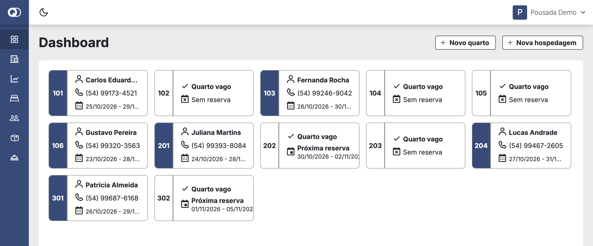

## About

Quarto Digital was my undergraduate final project (TCC) at Universidade de Passo Fundo (UPF) in 2022. The idea was a simple system for the front desk of a small hotel or inn: see at a glance which rooms are occupied, check guests in, record what they consume, check them out and follow occupancy and revenue over the year.

This repository is the app the staff uses. It talks to [api-quarto-digital](https://github.com/RanielliMontagna/api-quarto-digital) (Express, Prisma, PostgreSQL), and [landing-page-quarto-digital](https://github.com/RanielliMontagna/landing-page-quarto-digital) is the marketing site. Most building blocks (fields, data table, modal, drawer, page header, theme) come from [rm_monorepo](https://github.com/RanielliMontagna/rm_monorepo), the component library I kept at the time. The interface is in Portuguese.

## Features

- **Dashboard**: one card per room. Occupied rooms show the guest, phone and dates; free rooms show the next reservation, if any.
- **New stay wizard**: guest (pick one or create it on the spot), period, room and a summary before saving.
- **Stay details**: status, nights, daily rate, products and services consumed and the running total. From there you add consumption, check out, cancel or open a **receipt** rendered as an image.
- **Stays list** with status filter (active, reserved, finished, cancelled) and search.
- **Indicators**: occupancy rate, current guests, revenue this month, upcoming reservations and a revenue chart for the year.
- **Rooms, guests, products and services**: data tables with search, add and edit dialogs, delete confirmation and empty states. Guest forms validate CPF/CNPJ and can fill company data from a CNPJ lookup.
- **Auth**: sign-in, sign-out and password reset through a link sent by e-mail.
- **Light and dark themes**, and a mobile layout with a menu and a floating add button.
- **End-to-end tests** with Cypress for creating, editing and deleting rooms, guests, products and services.
- **Sentry** error tracking.

## Screenshots

All screenshots use sample data.

<table>
  <tr>
    <td width="50%">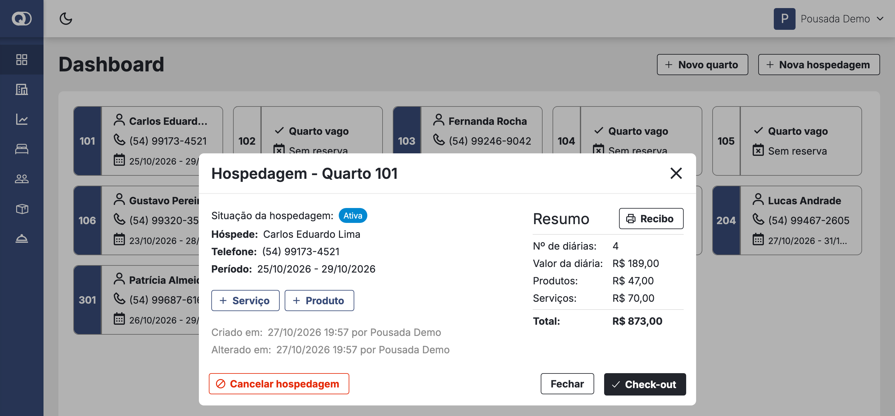<p align="center"><sub>Stay details with consumption and total</sub></p></td>
    <td width="50%">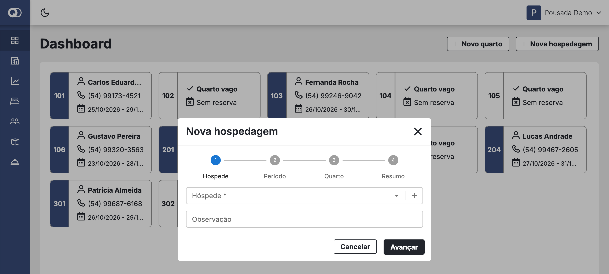<p align="center"><sub>New stay wizard</sub></p></td>
  </tr>
  <tr>
    <td width="50%">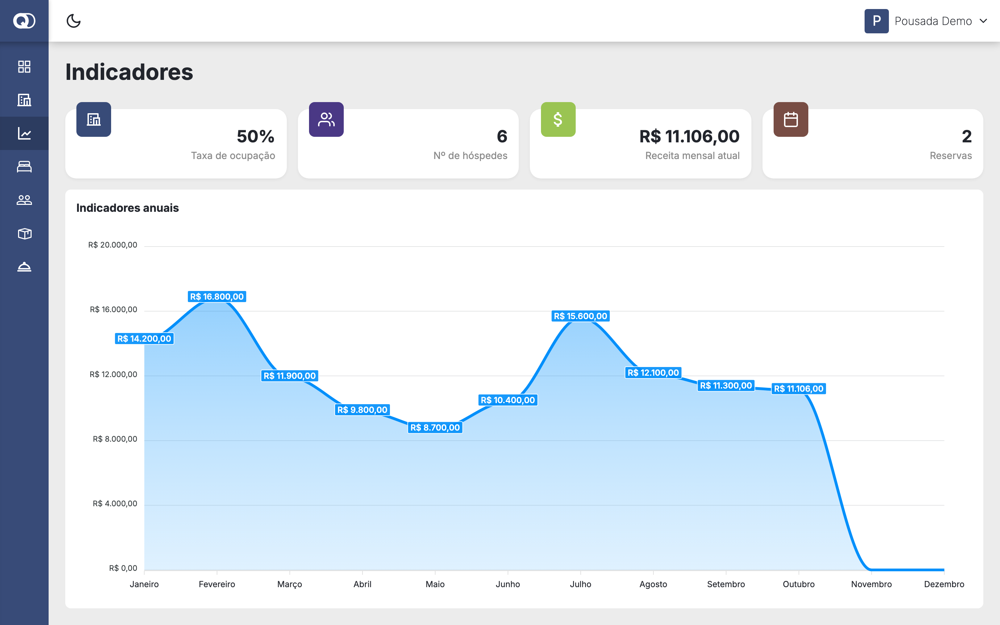<p align="center"><sub>Indicators</sub></p></td>
    <td width="50%">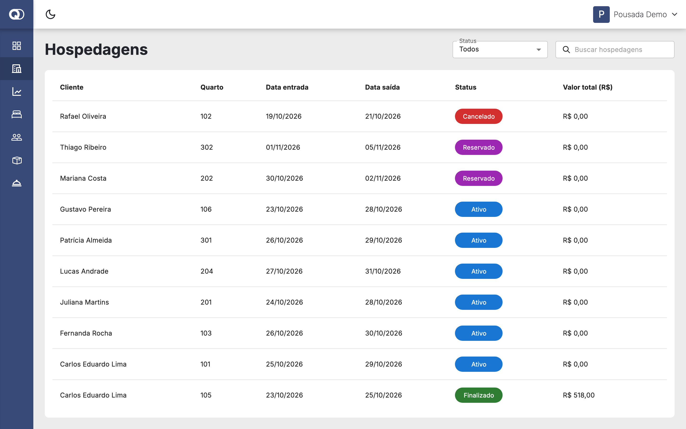<p align="center"><sub>Stays by status</sub></p></td>
  </tr>
  <tr>
    <td width="50%">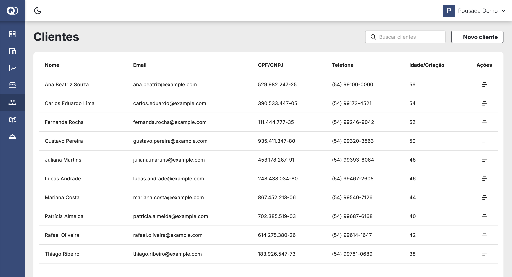<p align="center"><sub>Guests</sub></p></td>
    <td width="50%">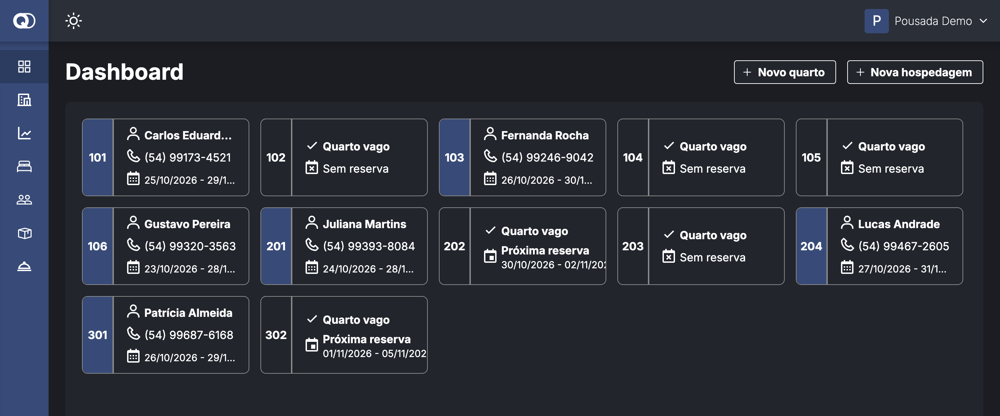<p align="center"><sub>Dark theme</sub></p></td>
  </tr>
  <tr>
    <td width="50%">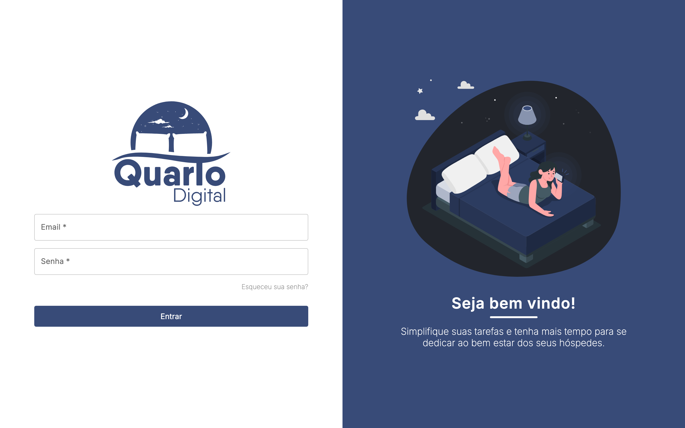<p align="center"><sub>Sign-in</sub></p></td>
    <td width="50%" align="center">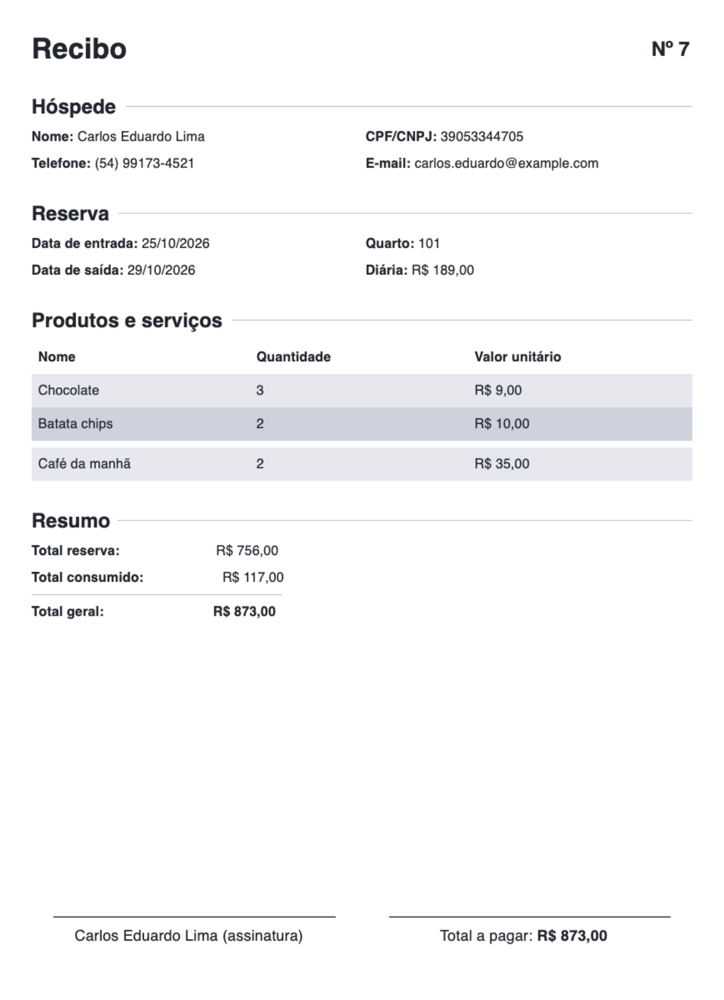<p align="center"><sub>Receipt generated for a stay</sub></p></td>
  </tr>
</table>

<p align="center">
  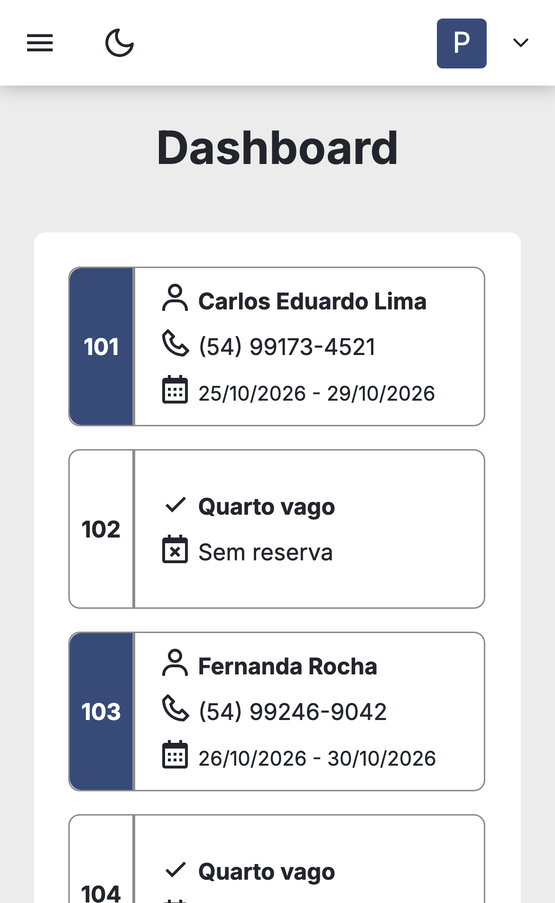
  &nbsp;&nbsp;
  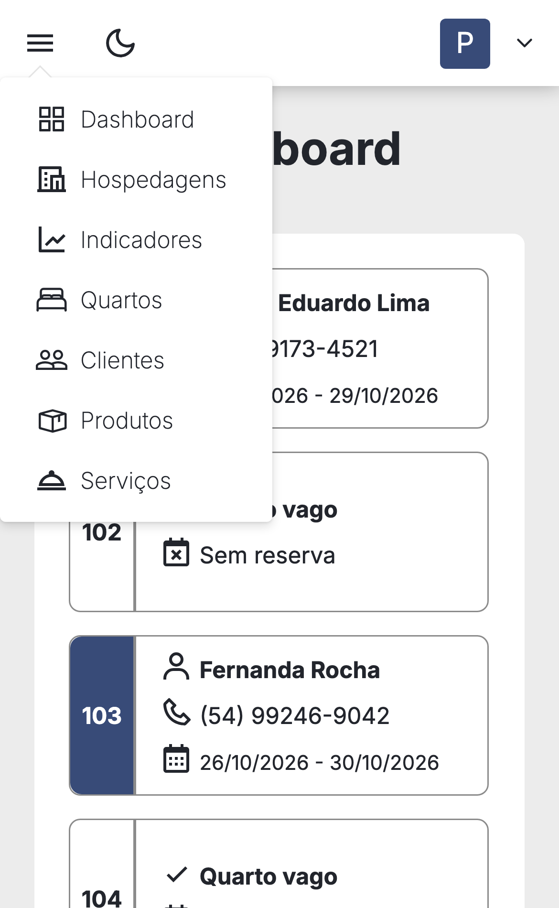
  <br />
  <sub>Dashboard and menu on a phone</sub>
</p>

## Architecture

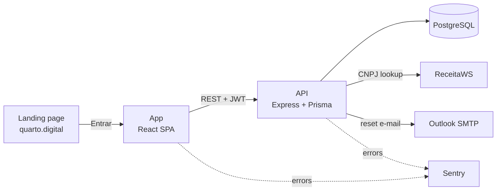

```text
src/
├── pages/        # one folder per screen: Dashboard (with the stay dialogs), Hospedagens, Indicadores,
│                 # Quartos, Clientes, Produtos, Servicos, Login, RedefinirSenha
├── shared/       # forms reused across screens (guest and room dialogs)
├── components/   # layout, drawers, room card, empty states, data table wrapper
├── service/      # axios calls per resource
├── store/        # Redux Toolkit slices for auth, theme and app state
├── hooks/        # CNPJ lookup, typed selector, theme
└── routes/       # public and private routes
cypress/e2e/      # CRUD tests for rooms, guests, products and services
```

## Tech stack

| Area | Tools |
| --- | --- |
| UI | React 17, TypeScript, MUI 5, MUI X Date Pickers, styled-components, styled-system, React Icons |
| Components | [`@rm-monorepo/*`](https://github.com/RanielliMontagna/rm_monorepo): fields, data table, modal, drawer, menu, page header, theme provider |
| State and forms | Redux Toolkit, React Router 6, React Hook Form, react-number-format |
| Data and charts | axios, Day.js, ApexCharts, notistack, dom-to-image-more |
| Build | Create React App 4 (react-scripts 4.0.3), Yarn 1 |
| Quality | Cypress, Testing Library, Sentry |

## Running locally

Last checked in October 2026 on macOS. You need [api-quarto-digital](https://github.com/RanielliMontagna/api-quarto-digital#running-locally) running on port 3333 first.

The twelve `@rm-monorepo/*` packages were removed from npm, so build them from the rm_monorepo commit of 10 November 2022 and point the app at the tarballs. Steps 1 and 2 work on current Node.js; Create React App 4 needs Node.js 16 to start.

<details>
<summary>Step by step</summary>

```bash
# 1. Build the @rm-monorepo packages
mkdir rm-tgz
git clone https://github.com/RanielliMontagna/rm_monorepo.git
cd rm_monorepo
git checkout bce4ea9
npx yarn@1 install --frozen-lockfile --ignore-scripts
for d in appBar button dataTable drawer fields loading menu modal pageHeader themeProvider typography utils; do
  (
    cd packages/$d
    npx tsc
    # packages that import a sibling's source compile to lib/<package>/src, so point lib/index at it
    if [ ! -f lib/index.js ]; then
      echo "module.exports = require('./$d/src/index.js');" > lib/index.js
      echo "export * from './$d/src';" > lib/index.d.ts
    fi
    npm pack --pack-destination ../../../rm-tgz
  )
done
cd ..

# 2. Install the app against the local tarballs
git clone https://github.com/RanielliMontagna/app-quarto-digital.git
cd app-quarto-digital
node -e '
const fs = require("fs")
const p = JSON.parse(fs.readFileSync("package.json"))
const tgz = fs.readdirSync("../rm-tgz")
for (const name of Object.keys(p.dependencies).filter((n) => n.startsWith("@rm-monorepo/"))) {
  const file = tgz.find((f) => f.startsWith("rm-monorepo-" + name.split("/")[1] + "-"))
  p.dependencies[name] = "file:../rm-tgz/" + file
}
fs.writeFileSync("package.json", JSON.stringify(p, null, 2))
'
CYPRESS_INSTALL_BINARY=0 npx yarn@1 install --ignore-engines

# 3. Run with Node.js 16
nvm use 16    # or: fnm use 16
REACT_APP_API_URL=http://localhost:3333 npx react-scripts start    # http://localhost:3000
```

</details>

Sign in with an account created through the API's `POST /register`. The Cypress tests expect `demo@quartodigital.dev` / `demo1234` and the app on port 3000: create that account, then run `npx cypress open` (drop `CYPRESS_INSTALL_BINARY=0` from the install to get the Cypress binary).

## Project history

- **January–March 2022**: the front end started in the [landing page repository](https://github.com/RanielliMontagna/landing-page-quarto-digital), with routes, light and dark themes, the app bar and drawer, the sign-in screen and Redux state for rooms, guests, products and services.
- **June 2022**: the app moved to this repository; products with add, edit and delete.
- **July 2022**: services, guests and form fields built on React Hook Form.
- **August 2022**: fields, modal, drawer, data table and page header moved to rm_monorepo.
- **September–October 2022**: password reset, Cypress tests and the first version of the new stay wizard.
- **November 2022**: dashboard cards, stays with products and services, check-out, cancellation, stays list, indicators and receipts. Final commit on 10 November 2022.
- **October 2026**: archived.

## Author

Built by [Ranielli Montagna](https://github.com/RanielliMontagna) · [ranimontagna.com](https://ranimontagna.com)
